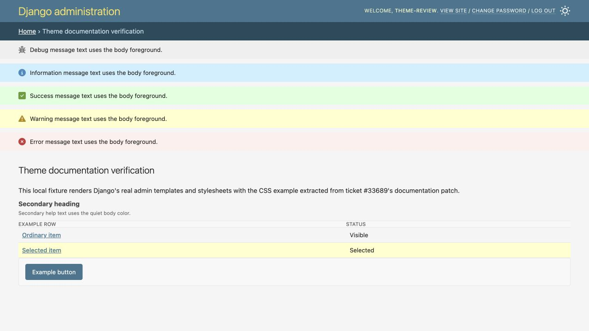
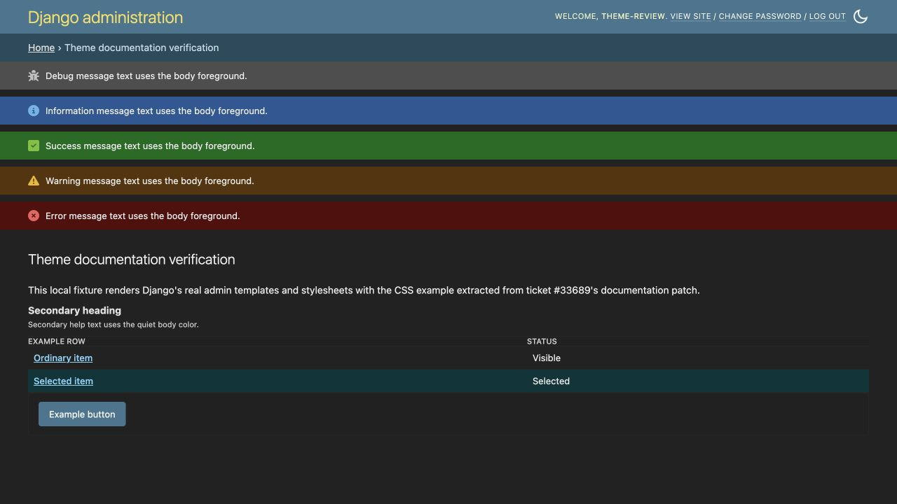

# Verification for Django #33689

This fork-only branch stores evidence for the documentation patch at `c400a15`. These files are not part of the upstream documentation PR.

## Checks

On Python 3.13.3 and Sphinx 9.2.0:

- `make html SPHINXOPTS='-q -W' JOBS=4`: passed.
- `make lint`: all 681 documentation sources passed.
- `make black`: all 681 documentation sources passed.
- `python -Wall tests/runtests.py -v2 sphinx_tests`: 31 tests passed.
- `make epubcheck`: passed with seven navigation-order warnings. An unchanged checkout at `d3954c981368eb4439be63f2f165d400f33bcd70` produced the same warnings.
- `make spelling SPHINXOPTS='-q -W'`: the local macOS Enchant/Aspell setup reports 31 warnings. Clean builds with the same settings on the patch and unchanged checkout produced exactly the same warning messages; none was introduced by the patch. See spelling-baseline-comparison.json.
- `git diff --check`: passed.

No Django backend code changes were made and the full backend test suite was not run.

## Browser fixture

`preview.py` renders Django's real admin base templates, theme toggle and stylesheets with a synthetic user/context. It extracts the CSS example directly from the modified documentation and applies it through a base-template override. It uses no database and is not a full admin/backend integration test.

Install Django and its docs requirements in a virtual environment, then run `python verification/preview.py` from this checkout. The server prints a dynamically allocated localhost URL. The optional `/docs/` route serves the HTML documentation after `make html`.

The in-app browser preferred dark mode. The actual theme toggle was used to check automatic, explicit light and explicit dark modes. Computed styles matched the documented body colors in each case, including explicit light mode overriding the system's dark preference. This was one browser and one system preference, not a cross-browser matrix.

`django-theme-checks.json` records those three cases and 27 sampled text/background contrast checks: body text, help text, secondary headings, selected-row links, and the five message levels. All sampled ratios were at least 4.5:1. This does not establish accessibility conformance for the whole admin interface.

| Explicit light | Explicit dark |
| --- | --- |
|  |  |

OpenAI Codex (GPT-6) assisted with source investigation, drafting and verification. Human author review of the proposed documentation is a separate step.
